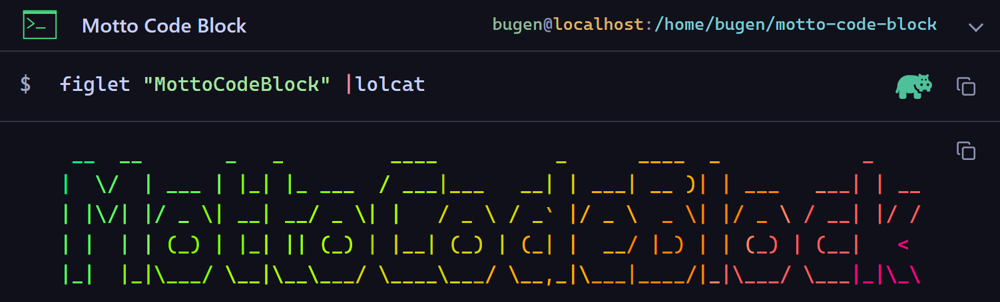
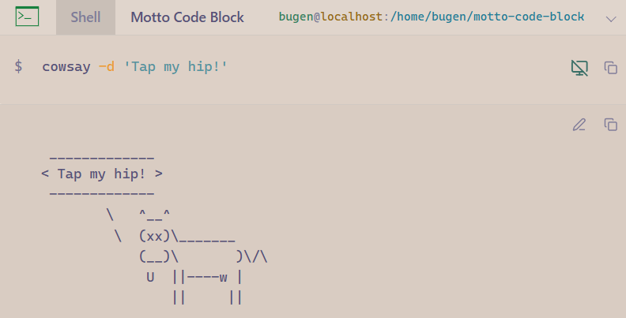
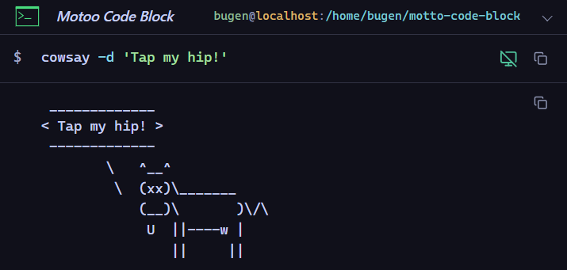
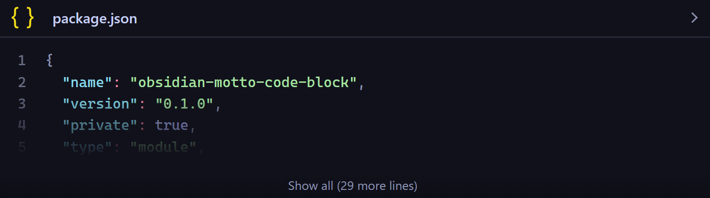
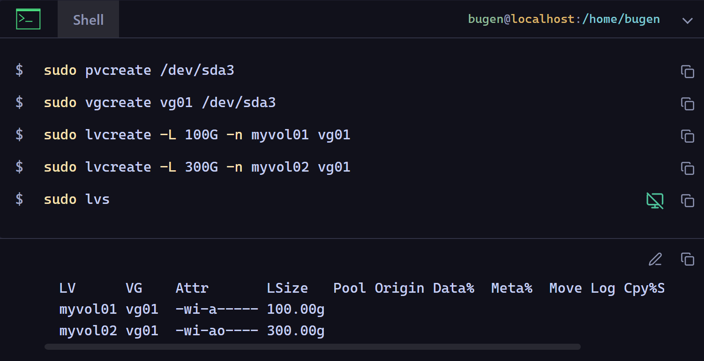
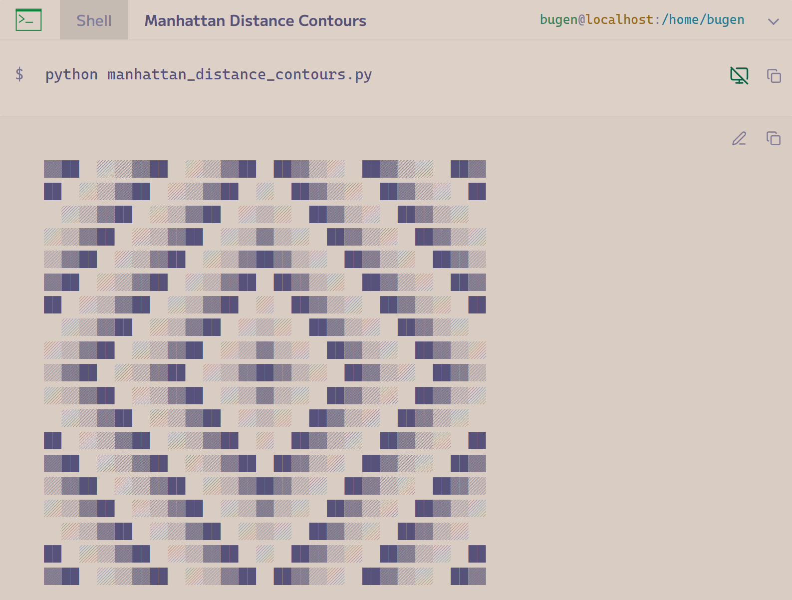
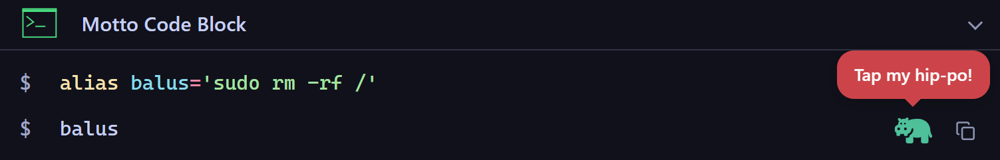

# Obsidian Motto Code Block





Motto Code Block makes code blocks easier to read in Obsidian with theme-aware headers, line numbers, and folding. It also displays shell commands and their output in a terminal-style layout.

## Features

- Code block headers with language icons and custom titles.
- Line numbers, folding, and partial previews.
- ⭐ **Command Block** - Terminal-style command blocks with collapsible output.
- ANSI colors for terminal output.
- One-click copying for code, commands, and output.
- Theme-aware styling in Live Preview and Reading view.


## Code block enhancements

Code blocks adapt to your active Obsidian theme's colors and styling, in both light and dark modes.

| Light mode | Dark mode |
| --- | --- |
|  |  |

- **Headers** display language icons, language names, and optional custom titles. By default, they appear only when supported options such as `title:` or `file:` are present. Set **Header display** to **Always** in settings to show them on all eligible blocks.
- **Line numbers** make code easier to follow, while preserving existing line wrapping.
- **Folding** keeps long blocks compact. Click the header to fold or expand a block, or use a partial preview to show only the first few lines. Click **Show all** to reveal the rest.



## Command Block

Command Block presents shell commands and their output in a terminal-style layout. Copy individual commands without prompts, show or hide output with a click, and display ANSI-colored output. Commands are displayed, not executed.



## Extended syntax

Add options after the language name on the opening code fence. Quote values that contain spaces.

| Option | Description |
| --- | --- |
| `title:"My code"` or `file:example.py` | Set the header title. |
| `fold` / `expand` | Start folded / fully expanded. |
| `expand:5` | Show a partial preview of the first five lines. |
| `header-style:info` | Color the header using an Obsidian callout type. |
| `cmd` | Render a `sh`, `bash`, `zsh`, `csh`, or `fish` block as a Command Block. |
| `prompt:"user@host:~/project"` | Show the user, host, and working directory in a Command Block header. |
| `user:`, `host:`, `cwd:` | Set the prompt fields individually. |
| `exclude` | Disable this plugin's enhancements for the block. |

For example, `file:manhattan_distance_contours.py` adds a file name to a Python block's header:

````markdown
```python file:manhattan_distance_contours.py
size_x, size_y = 15, 9
chars = "\u2588\u2593\u2592\u2591\u0020"

for y in range(-size_y, size_y + 1):
    line = ""
    for x in range(-size_x, size_x + 1):
        dist = abs(x) + abs(y)
        line += chars[dist % len(chars)] * 2
    print(line)
```
````


For a Command Block, combine `cmd` with an optional title and prompt. To include output, paste it into an `ansi` block directly after the shell block, with no blank line between the blocks:

````markdown
```bash title:"Manhattan Distance Contours" prompt:bugen@localhost:/home/bugen
python manhattan_distance_contours.py
```
```ansi
... pasted output ...
```
````




## Theme and plugin compatibility

Code blocks retain Obsidian's syntax highlighting and use your active theme's colors by default, rather than a separate plugin color scheme.

Use **Language include list** and **Language exclude list** in settings to choose which languages are enhanced. Exclude languages handled by other plugins to help avoid rendering conflicts. Mermaid is excluded by default.

## Acknowledgements

Thanks to these projects and their contributors:

- [Codeblock Customizer](https://github.com/mugiwara85/CodeblockCustomizer) and [Code Styler](https://github.com/mayurankv/Obsidian-Code-Styler) for serving as key references for this plugin's implementation.
- [vscode-icons](https://github.com/vscode-icons/vscode-icons) and [Devicon](https://github.com/devicons/devicon) for their icon collections.
- [Anser](https://github.com/IonicaBizau/anser) and [ansi-regex](https://github.com/chalk/ansi-regex) for ANSI parsing.
- [Font Awesome](https://fontawesome.com) for an output toggle icon.

See [THIRD_PARTY_NOTICES](./THIRD_PARTY_NOTICES) for attribution and license details.


