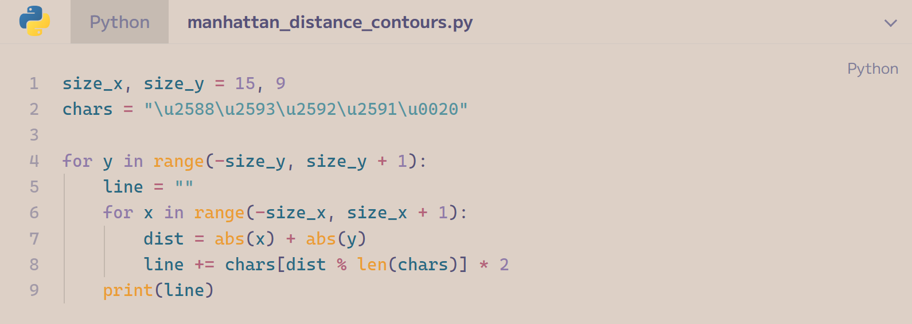

# Obsidian Motto Code Block


Motto Code Block makes code blocks easier to read in Obsidian with theme-aware headers, line numbers, and folding. It also displays shell commands and their output in a terminal-style layout.

## Features

- Code block headers with language icons and custom titles.
- Line numbers, folding, and partial previews.
- ⭐ **Command Block** - Terminal-style command blocks with collapsible output.
- ANSI colors for terminal output.
- One-click copying for code, commands, and output.
- Theme-aware styling in Live Preview and Reading view.


## Code block enhancements

Code blocks adapt to your active Obsidian theme's colors and styling, in both light and dark modes.

| Light mode | Dark mode |
| --- | --- |
|  |  |

- **Headers** display language icons, language names, and optional custom titles. By default, they appear only when supported options such as `title:` or `file:` are present. Set **Header display** to **Always** in settings to show them on all eligible blocks.
- **Line numbers** make code easier to follow, while preserving existing line wrapping.
- **Folding** keeps long blocks compact. Click the header to fold or expand a block, or use a partial preview to show only the first few lines. Click **Show all** to reveal the rest.


## Command Block

Command Block presents shell commands and their output in a terminal-style layout. Copy individual commands without prompts, show or hide output with a click, and display ANSI-colored output. Commands are displayed, not executed.

The default **Command languages** are `sh`, `bash`, `zsh`, `csh`, `fish`, and `powershell`. To use another shell, add its fence name (such as `dash`) under **Command blocks → Command languages**, then use a fence like `dash cmd`. You do not need to add it to the general include list. The exclude list and `exclude` still take precedence.

Click a command's prompt to toggle line wrapping for that command, including any continuation lines. With wrapping off, scroll horizontally to read long lines.
`powershell` blocks keep the PowerShell icon, show `>` instead of `$` or `#`, and use a trailing backtick to continue a command on the next line.

In Reading view, consecutive `cmd` blocks with no blank lines between them are displayed as one compact terminal session. Live Preview keeps them separate for editing. Each output still opens and closes independently. Insert a blank line after a command and its output to start a new session.

Use the two-line menu icon beside the first command to open or close all outputs in that session, restore their fence defaults, switch prompt display, or copy all commands without prompts or output. When space is tight, the icon appears next to the command controls without the round background. These actions do not edit the note.

In Live Preview, use the trash icon beside the pencil to delete only the output. To delete the whole command block and its output, hover briefly over the first command line or focus its controls. The trash icon appears just outside the right edge, or in the left margin if the pane is too narrow. Both actions edit the note and can be undone with the editor's Undo command.


Standalone `ansi` blocks show the ANSI logo when their header and icons are enabled. In any `ansi` preview, the copy icon copies plain text; **RAW** copies the full text with ANSI escape sequences.

## Command palette

Search for **Motto Code Block** in the command palette. These display commands apply to the active note in Live Preview and Reading view without editing the note:

- **Fold all code blocks** / **Expand all code blocks**: Change only blocks with headers, including Command Block bodies.
- **Close all command outputs** / **Open all command outputs**: Change paired outputs even when their Command Blocks have no header. Opening also expands the parent Command Blocks and shows the full output.
- **Reset block folding and output visibility**: Restore the defaults from the fence options and plugin settings.

To paste a terminal session, copy the transcript starting with its first prompt. In Live Preview or Source mode, place the cursor outside existing code blocks and run **Paste terminal output (keep ANSI)** or **Paste terminal output (strip ANSI)**. Both create editable Markdown; the first preserves escape sequences in `ansi` output blocks, and the second writes plain output in `plaintext` blocks.

If automatic detection picks the wrong shell, use **Paste Bash terminal output** (shell prompts ending in `$`, `#`, or `%`) or **Paste PowerShell terminal output** (`>` prompts). Both are available with **keep ANSI** and **strip ANSI**. The detected prompt is saved with each command; hover over its symbol to see the full text.

Under **Command blocks → Terminal prompt patterns**, common Bash, Zsh, and PowerShell patterns are enabled by default. Click **Add pattern** to enter a custom JavaScript regular expression, such as `^dev:[^$]+\$`. Match from the start through the final prompt symbol, but not the following space. Use the switch beside each pattern to enable or disable it. Custom patterns are tried before presets; automatic detection is still used if none match.

Under **Command blocks → Ignored terminal command suffixes**, enter one literal string per line. Paste commands skip matching command entries and their output. The default `^C` skips canceled inputs such as `^C` and `cd ^C`; clear the setting to keep them.

## Extended syntax

Add options after the language name on the opening code fence. Quote values that contain spaces.

| Option | Description |
| --- | --- |
| `title:"My code"` or `file:example.py` | Set the header title. |
| `fold` / `expand` | Start folded / fully expanded. |
| `expand:5` | Show a partial preview of the first five lines. |
| `header-style:info` | Color the header using an Obsidian callout type. |
| `cmd` | Render a fence listed in **Command languages** as a Command Block. |
| `prompt:"user@host:~/project"` | Show the user, host, and working directory in a Command Block header. |
| `prompt-text:"(PROD) [user@host ~]$"` | Use the literal prompt, including its final `$`, `#`, `%`, or `>`, instead of reconstructing it from the prompt fields. |
| `prompt-display:inline` | Show the prompt on the command line instead of in the header. If space is limited, only the part before the prompt symbol is shortened. |
| `prompt-display:hide` | Show only the prompt symbol on the command line. Hover over the symbol to see the full prompt above it. |
| `user:`, `host:`, `cwd:` | Set the prompt fields individually. |
| `exclude` | Disable this plugin's enhancements for the block. |

For example, `file:manhattan_distance_contours.py` adds a file name to a Python block's header:

````markdown
```python file:manhattan_distance_contours.py
size_x, size_y = 15, 9
chars = "\u2588\u2593\u2592\u2591\u0020"

for y in range(-size_y, size_y + 1):
    line = ""
    for x in range(-size_x, size_x + 1):
        dist = abs(x) + abs(y)
        line += chars[dist % len(chars)] * 2
    print(line)
```
````



For a Command Block, combine `cmd` with an optional title and prompt. Place output directly after the shell block, with no blank line between them. By default, `ansi`, `plaintext`, and unlabelled fences can serve as output:

````markdown
```bash title:"Manhattan Distance Contours" prompt:bugen@localhost:/home/bugen
python manhattan_distance_contours.py
```
```ansi
... pasted output ...
```
````


## Theme and plugin compatibility

Code blocks retain Obsidian's syntax highlighting and use your active theme's colors by default, rather than a separate plugin color scheme.

Use **Language include list** to choose languages for ordinary code block enhancements and command output. **Language exclude list** also takes precedence over **Command languages**. Exclude languages handled by other plugins to avoid rendering conflicts. Mermaid is excluded by default.

## Acknowledgements

Thanks to these projects and their contributors:

- [Codeblock Customizer](https://github.com/mugiwara85/CodeblockCustomizer) and [Code Styler](https://github.com/mayurankv/Obsidian-Code-Styler) for serving as key references for this plugin's implementation.
- [vscode-icons](https://github.com/vscode-icons/vscode-icons) and [Devicon](https://github.com/devicons/devicon) for their icon collections.
- [Anser](https://github.com/IonicaBizau/anser) and [ansi-regex](https://github.com/chalk/ansi-regex) for ANSI parsing.
- [Font Awesome](https://fontawesome.com) for an output toggle icon.

See [THIRD_PARTY_NOTICES](./THIRD_PARTY_NOTICES) for attribution and license details.


